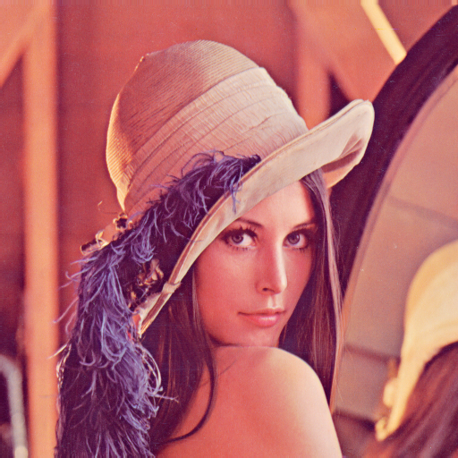
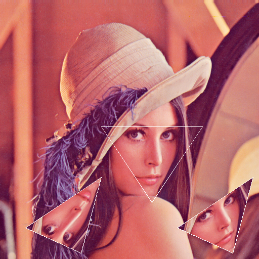
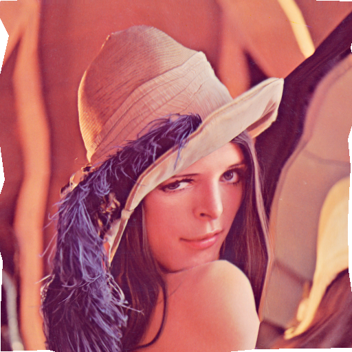
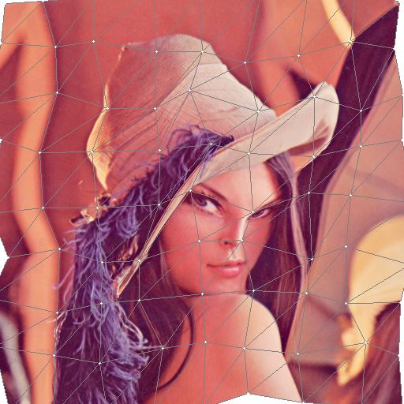

= Triangle Warp

Triangle Warp is a CPU-based rasterizer for mapping the pixels in a source triangle onto a triangular area in a destination image.

The main *functionality is warp* of a triangle.
Warping a triangle-shaped excerpt of a source image on to a different-shaped triangle on a destination image.

The *secondary functionality is morph* of a triangle.
Morphing a first triangle-shaped excerpt of a first source image into a secondary different-triangle-shaped excerpt of a secondary source image on to a different-shaped triangle on a destination image.

This library also supports warping or morphing an image through a *mesh* of triangles.

== Install

[source, bash]
----
go get github.com/chran554/go-trianglewarp@latest
----

Import the package as `warp`:

[source, go]
----
import warp "github.com/chran554/go-trianglewarp"
----

== Warp a triangle

`warp.Warp` maps the pixels inside `srcTriangle` from `srcImage` onto `dstTriangle` in `dstImage`. A `Triangle` contains pointers to its three `image.Point` values.

The destination image must implement `draw.Image`.

[source, go]
----
import (
	"image"

	warp "github.com/chran554/go-trianglewarp"
)

func warpTriangle() {
	srcImage := image.NewRGBA(image.Rect(0, 0, 512, 512))
	dstImage := image.NewRGBA(srcImage.Bounds())

	srcTriangle := warp.Triangle{
		P1: &image.Point{X: 200, Y: 250},
		P2: &image.Point{X: 400, Y: 250},
		P3: &image.Point{X: 300, Y: 400},
	}
	dstTriangle := warp.Triangle{
		P1: &image.Point{X: 350, Y: 450},
		P2: &image.Point{X: 500, Y: 350},
		P3: &image.Point{X: 460, Y: 500},
	}

	warp.Warp(srcImage, srcTriangle, dstImage, dstTriangle, nil)
}
----

== Warp Options

Options can be sent to the `Warp` function.

The main option is the interpolation option.
`warp.InterpolationDefault` is the default and it is an alias for `warp.InterpolationBiLinear`.

`Options` also accepts optional `TriangleSideColor` and `TrianglePointColor` values for drawing the destination triangle’s sides and points after the warp. This is mainly used for debugging.

== Example

The example images below show the source image and the result of rendering warped triangles onto it.

.Source image of Lena

.Lena with warped triangles

== Warp a mesh

`warp.NewMesh` creates a rectangular grid of triangles with the requested number of subdivisions. `warp.WarpMesh` maps corresponding subdivision triangles from a source mesh to a destination mesh. The destination mesh can be distorted by changing the points returned by `Mesh.Point`; mesh points are shared by adjacent triangles.

[source, go]
----
import (
	"image"

	warp "github.com/chran554/go-trianglewarp"
)

func warpMesh(srcImage image.Image) *image.RGBA {
	srcBounds := srcImage.Bounds()
	dstImage := image.NewRGBA(srcBounds)

	xDivisions := 12
	yDivisions := 8
	srcMesh := warp.NewMesh(srcBounds, xDivisions, yDivisions)
	dstMesh := warp.NewMesh(srcBounds, xDivisions, yDivisions)

	// Move one shared destination point to distort the grid.
	if p := dstMesh.Point(6, 4); p != nil {
		p.X += 20
		p.Y += 20
	}

	warp.WarpMesh(srcImage, srcMesh, dstImage, dstMesh, nil)
	return dstImage
}
----

.Warped image using a distorted mesh

.Warped image with the destination mesh overlaid

== Morph between triangles

`warp.Morph` interpolates both the image content and the triangle position between two source images.

The destination triangle shape, location and pixel color content are computed by interpolating by the corresponding source and destination points.

The interpolation `progress` is normally in the range `0.0` to `1.0`; `0.0` selects the first image and triangle, while `1.0` selects the second triangle.

[source, go]
----
Morph(
	srcImage1 image.Image, srcTriangle1 Triangle,
	srcImage2 image.Image, srcTriangle2 Triangle,
	dstImage draw.Image,
	progress float64,
	options *Options)
----

Use `warp.MorphWithFixedDestination` when the output must remain inside an explicit destination triangle:

[source, go]
----
MorphWithFixedDestination(
	srcImage1 image.Image, srcTriangle1 Triangle,
	srcImage2 image.Image, srcTriangle2 Triangle,
	dstImage draw.Image, dstTriangle Triangle,
	progress float64,
	options *Options)
}
----

== Dependencies

The package uses https://github.com/chran554/go-bresenham/[go-bresenham] for line rasterization. All other functionality uses the Go standard library.

== License

https://creativecommons.org/publicdomain/zero/1.0/[CC0 - Creative Commons 0 (v1.0)]

image::http://mirrors.creativecommons.org/presskit/buttons/80x15/png/cc-zero.png[CC0]

It is not a requirement by the license, but if you do improve the code then any feedback or pull request is very appreciated. Sharing is caring.

== Inspiration and primary recipes

* https://jtsorlinis.github.io/rendering-tutorial/[Rasterising a triangle] by Jason Tsorlinis

* https://fgiesen.wordpress.com/2013/02/06/the-barycentric-conspirac/[The barycentric conspiracy] by Fabian “ryg” Giesen

* https://fgiesen.wordpress.com/2013/02/10/optimizing-the-basic-rasterizer/[Optimizing the basic rasterizer] by Fabian “ryg” Giesen
